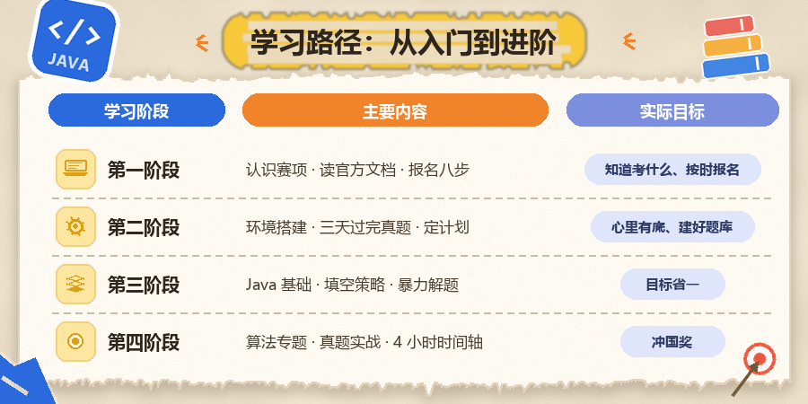

# wy-lanqiao-paths

作者署名：梧焰。

这个仓库是两份备赛笔记的**公开橱窗**：课程说明和大纲在这里，完整正文不在这里。

> 文中出现的赛事名称仅用于说明学习内容来源。本项目是个人学习笔记，与赛事主办方无隶属、授权或官方背书关系。

## 这里有什么

- [Java 组：课程说明与大纲](docs/java-group/课程说明与大纲.md)
- [智能体开发：课程说明与大纲](docs/agent-dev/课程说明与大纲.md)

看完这两份，你能知道：这是什么、适不适合你、按什么顺序走、大概要花多少时间。

## 这里没有什么

- **课程正文**：不在仓库里，需要授权后访问。仓库不放链接——链接指向有权限的文档，点开只会看到「无权限」，没有意义。
- **附赠资料**：不在仓库里，也不在公开大纲里展开。
- **网盘、公众号、飞书的深链**：一律不放，避免过期或权限问题。

想获取完整版：`TODO：在这里填写你的入口（公众号文章 / 购买页 / 申请方式）`




## 目录

```
docs/
├── java-group/       Java 组说明与大纲（公开）
├── agent-dev/        智能体开发说明与大纲（公开）
├── design/           配图风格配方
└── 付费版本说明.md
scripts/              配图生成脚本
assets/               配图
```

## 本地生成配图

需要 Python 3 + `Pillow` + `numpy`，字体使用 Windows 自带的微软雅黑。

```bash
python scripts/blue-tech-poster/gen.py --out ./poster.png
python scripts/paper-learning-path/gen.py --out ./path.png
```

换标题、标签、数据，只改对应脚本同目录下的 `content.json`，不动坐标。

## 许可

- 文档与配图（所有 Markdown 和 `assets/`）：[CC BY-NC-SA 4.0](LICENSE-DOCS)。可分享、可改编，需署名、禁止商用、衍生作品同协议。
- 代码（`scripts/`）：[MIT](LICENSE-CODE)。可用于商业项目。

他人不得把本仓库的公开文档直接拿去售卖或作为付费课程主体。作者保留全部著作权。

## 交流

发现错别字、事实过期，欢迎提 Issue。Pull Request 请只改一处问题，别顺手润色语气——这是作者的表达习惯。
